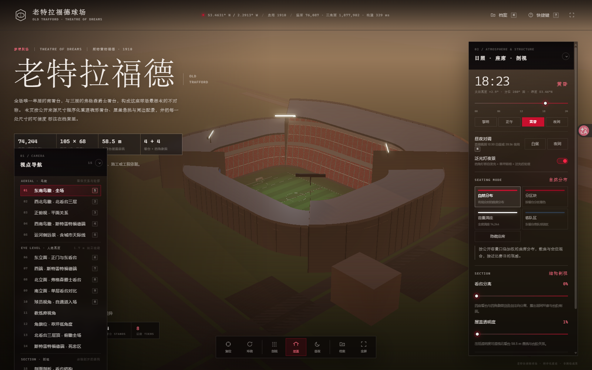

# 老特拉福德球场 · 交互式三维展览

**Old Trafford · Interactive Architectural Model**

> 一个可以自由看、剖、拆、点开档案的老特拉福德三维展览：真实测绘模型 + 程序化组织 +
> 浏览器内实时渲染，附带 16 个机位（含死忠区阵容站位视角）、昼夜光照、结构剖视、
> 座席模式、看台分解、曼联球员卡抽屉、队史档案库与队歌播放。



**许可：MIT** · 纯静态页面 · 无需构建 · Three.js 已本地化（离线可用）

---

## 目录

- [一、这是什么](#一这是什么)
- [二、快速开始](#二快速开始)
- [三、目录结构](#三目录结构)
- [四、界面与交互](#四界面与交互)
- [五、模型与坐标约定](#五模型与坐标约定)
- [六、数据契约 jsdatajs](#六数据契约-jsdatajs)
- [七、装配器 jsstadiumjs](#七装配器-jsstadiumjs)
- [八、桌面版exe](#八桌面版exe)
- [九、工具脚本](#九工具脚本)
- [十、已知限制与诚实清单](#十已知限制与诚实清单)
- [十一、版权与合规](#十一版权与合规)
- [十二、上传到-GitHub-的注意事项](#十二上传到-github-的注意事项)

---

## 一、这是什么

一个**单页三维展览**：页面里没有贴图长卷、没有预渲染影片，而是把一座 28 MB 的
老特拉福德实测模型（glTF 2.0 / GLB）拆成四座看台，用 Three.js 在浏览器里实时绘制，
再叠上一层解释性界面——视点导航、日照与座席模式、结构剖视、看台分解、档案抽屉、
队史档案库与队歌。

模型的原始朝向是真实地理朝向（草坪长轴相对正北偏转约 28°），装配时绕 Y 轴旋转
`332.0653°` 把它摆正成「北 = -Z、东 = +X、草坪长轴沿 X」，与页面里所有机位和数据
（`north-facade`、`aerial-se`、东看台 = +X）保持一致。

主要数字（页面顶栏与「档案」面板实时给出）：

| 指标 | 数值 | 说明 |
| --- | --- | --- |
| 三角面 | 178,742 | 模型原始几何，未做简化 |
| 座席 | ≈ 74,500 | 按看台台面水平投影面积 ÷ 0.30 m²/座 推算，官方容量 74,197 |
| 看台 / 层段 | 4 / 8 | 北、东、西各三层，南看台单层 |
| 材质 / 贴图 | 91 / 86 | 来自摄影测量模型的照片贴图 |
| 部件 | ≈ 1,280 | 按三角面拆到四座看台之后 |

## 二、快速开始

页面用 ES module + importmap 加载 Three.js，**必须通过 http:// 打开**，双击
`index.html` 会因为 `file://` 协议加载不了模块而白屏。

### 方式 1：双击启动器（推荐）

```
双击 启动.bat
```

它会优先用 `python -m http.server 8080` 起一个本地服务并自动打开浏览器；没装 Python
时回退到 `npx --yes serve -l 8080`。

### 方式 2：手动起服务

```bash
# 在项目根目录（与 index.html 同级）
python -m http.server 8080
# 或
npx serve -l 8080
```

然后打开 <http://127.0.0.1:8080/>。

### 方式 3：桌面版

仓库里不带编译好的 exe（68 MB 的构建产物），可以自己打一个，见
[八、桌面版（exe）](#八桌面版exe)。

## 三、目录结构

```
.
├── index.html                  # 页面骨架：遮罩、面板、底部坞、档案抽屉
├── styles.css                  # 全部样式（含响应式与无障碍）
├── js/
│   ├── app.js                  # 渲染主程序：场景、光照、拾取、面板联动、队歌
│   ├── data.js                 # 数据契约：看台/视点/周边/色板/队史
│   └── stadium.js              # GLB 装配器：标定、分看台、材质分类、动画接口
├── assets/
│   ├── old-trafford.glb        # 实测模型（27.6 MB）
│   ├── manchester-united-anthem.mp3
│   ├── favicon.png
│   ├── 预览-*.png              # README 与文档用的渲染图
│   └── drawings/               # 逐层平面图与剖面图
├── vendor/                     # Three.js r169 全量本地化（禁止 CDN）
│   ├── three.module.js
│   └── addons/{controls,loaders,postprocessing,shaders,utils}
├── desktop/                    # 桌面版打包源码
│   ├── app.py                  # 内置静态服务 + Edge --app 窗口 + 心跳退出
│   ├── host.html               # 窗口外壳（iframe + 心跳）
│   ├── make_icon.py, icon.ico
│   └── old_trafford.spec       # PyInstaller onedir 配置
├── tools/                      # 图纸生成与几何校验脚本
├── docs/                       # 数据源清单、拍摄计划、研究笔记、历史说明、项目开发日志
├── 启动.bat
├── LICENSE                     # MIT
└── README.md
```

## 四、界面与交互

### 键盘

| 键 | 作用 |
| --- | --- |
| `1`–`9`、`0` | 切换视点（对应视点面板里的编号） |
| `[` / `]` | 上/下一个视点 |
| 空格 | 循环播放/暂停自转 |
| `r` | 复位视角 |
| `n` | 切换白昼/夜晚 |
| `e` | 展开/收起控制台 |
| `x` | 看台分解（爆炸图） |
| `c` | 结构剖视 |
| `k` | 周边配景开关 |
| `m` | 队歌播放/停止 |
| `v` | 「控制 / 队史」两块控制台面板互切 |
| `k` | 档案抽屉 |
| `p` | 「曼联球员」球员卡抽屉（顶栏同款入口） |
| `h`、`?` | 帮助 |
| `f` | 全屏 |

### 鼠标与触控

左键拖拽旋转、滚轮缩放、右键拖拽平移；悬停看台会出现包围盒与名称，
点击看台打开它的档案卡片。

### 五块折叠面板

左右各一组侧边面板列，**同一侧同一时间只展开一个**，展开另一块时前一块自动收起：

1. **视点导航（01 / CAMERA，左列）**：鸟瞰 5 个机位 + 剖视 1 个。
2. **观众视角（02 / VIEWER，左列）**：9 个人眼高度机位。
3. **阵容站位（03 / LINEUP，右列）**：死忠区阵容机位入口 + 11 人名单（门将 → 前锋，
   点名单直达该球员特写）。锁定在球门后，草坪上 11 个红色人形按 4-2-3-1 站位
   （装配器自动对齐西端球门，门将在球门正前方居中），教练区另有**黑色**主教练人形
   （迈克尔·卡里克，靠近可看正式教练卡面）。鼠标靠近任一人形或点名单即锁定推近，
   翻转式球员卡以人形脚底为底、向上盖住人形；退出锁定后 1 s 才重新开始靠近判定。
   Esc 回总览。
   **换人**：「曼联球员」抽屉的替补卡上点「换上」，再点场上人形（或阵容名单行）
   即完成对调，被换下的自动回替补席；Esc 取消换人。
   **阵容切换**：阵容面板的 SQUAD 段控提供「现役 2026-27 / 队史最佳 XI」两套阵容。
   队史最佳为 4-4-2（舒梅切尔；内维尔、费迪南德、维迪奇、埃尔文；贝斯特、基恩、
   斯科尔斯、吉格斯；查尔顿、劳），主教练人形换为**弗格森**（黑色人形，靠近看
   正式教练卡面），替补席 10 人（坎通纳、C罗、贝克汉姆、鲁尼、斯塔姆、埃弗拉、
   爱德华兹、范德萨、范尼、索尔斯克亚）带金色 LEGEND 徽标，可像现役阵容一样
   「换上」登场；阵型网格在队史模式下停用。切换时人形整体补间走位，评选口径为
   媒体与名宿评选、非官方（详见 `docs/曼联历史最佳阵容卡面资料.md`）。
   **阵型切换**：阵容面板的 FORMATION 网格提供 8 套热门阵型（4-2-3-1 / 4-3-3 /
   3-4-2-1 / 4-1-4-1 / 4-4-2 / 3-5-2 / 5-3-2 / 3-2-4-1，数据在 `data.js` 的
   `FORMATIONS`，含来源注记）。切换时 11 个人形补间走位、人员分配不变，镜头自动
   升到草坪正上方的高空俯视，走位完成后回落总览；换人过程同样使用俯视镜头。
   退出锁定后 1 s 才重新开始靠近判定。Esc 回总览。
   **传奇球星图鉴**：「曼联球员」抽屉在现役分组之后以标题栏分隔出
   「传奇球星 / LEGENDS」图鉴区，收录队史最佳 11 人、传奇替补 10 人与弗格森
   （共 22 张卡，金色 LEGEND 徽标，纯浏览可翻面）；切到队史阵容时上方分组已展示
   的传奇卡自动去重。
   **自定义球员卡**：「曼联球员」抽屉顶部「＋ 添加自定义球员卡」横条打开表单，填写姓名、
   号码、位置、国籍与背面数据（可上传卡面照片，自动压缩后保存在本机浏览器
   localStorage）。保存后自动进入替补席，与官方名单同一套换人体系——「换上」登场后
   阵容名单、场上人形与 3D 特写卡面同步出现；没传照片时卡面用深红占位底图。
   自定义卡带金色 CUSTOM 徽标与「编辑 / 删除」按钮组——编辑可随时改信息（表单
   预填、保存后抽屉/名单/场上卡面就地刷新，正在场上或 3D 特写中也生效）；删除正在
   场上的自定义球员会自动换回原首发十一人。刷新或重启后仍在，仅存于本机、
   不写回 `js/data.js`。
4. **控制台（04 / ATMOSPHERE & STRUCTURE，右列）**：日照时间轴与相位、泛光灯、
   昼夜对调、座席模式、看台分解、屋盖透明度、结构剖视、周边配景、自转。
5. **队史档案库（05 / HERITAGE，右列）**：与控制台同位互切，含队歌、时间轴与荣誉数字。

底部的「档案」抽屉另有统计、看台明细、来源与免责声明、快捷键清单。

## 五、模型与坐标约定

- **世界坐标**：Y 向上；北 = `-Z`，南 = `+Z`，东 = `+X`，西 = `-X`；草坪长轴沿 X，
  草坪顶面在 `y = 0`。
- **模型标定**（`js/stadium.js` 顶部的常量）：

  ```js
  const MODEL_PITCH_AXIS_DEG = 152.0653;                 // 草坪长轴相对模型 +X 的方位
  const MODEL_YAW_DEG = MODEL_PITCH_AXIS_DEG + 180;      // 332.0653 → 北落到 -Z
  const MODEL_PITCH_CENTER = { x: -5.161, z: 14.098 };   // 草坪中心
  const MODEL_PITCH_TOP_Y = 8.151;                       // 草坪顶面
  ```

  装配链是 `root → yawGroup(rotation.y) → alignGroup(position)`，先转正再平移，让草坪
  中心落到原点、顶面落到 `y = 0`。若发现南北反了，把 `MODEL_YAW_DEG` 加减 180 即可。

- **分看台**：模型是整体网格（连座席台面 `*1` 都只有 3 大块），所以装配器把每个
  三角面按质心分到 `north / south / east / west` 四个桶，再各自成组；低于 2.5 m 的
  扁平壳体进 `site`（场地），半径 > 118 m 的进 `context`（周边）。剖切、分解、
  拾取、分看台着色都建立在这个切分上。
- **材质分类**：`*1`（座席台面）、`*7` + `305px-Man_Utd_FC_.svg`（座席点与队徽）、
  `*30` + `*36`（屋盖面板与钢桁架）、`*6` / `*18`（草坪）。
- **材质修正**：GLB 里 91 个材质都带 `KHR_materials_ior: 1000`（Blender 把「高光 0」
  导出成了 IOR 1000），Three.js 照抄会让整座球场像镀了一层镜子。装配器统一把
  `ior > 2` 的材质改回 `1.5`，照片贴图的固有色才恢复。

## 六、数据契约 js/data.js

`js/data.js` 是唯一的「事实来源」，`app.js` 与 `stadium.js` 都只读它：

| 导出 | 内容 |
| --- | --- |
| `META` | 名称、经纬度、启用年份、座席与三角面的声明值 |
| `PITCH` / `RUN_OFF` / `BOWL_INNER` / `SEATING` | 场地与碗体的尺寸约定 |
| `STANDS` / `STAND_ORDER` | 四座看台的名称、层段、排数、说明 |
| `QUADRANTS` / `FEATURES` / `CONTEXT` / `EXTERIOR` | 名称与方位、特征构件、周边体量、外立面参数 |
| `VIEWPOINTS` | 15 个机位：`pos`、`target`、`fov`、`note`、可选 `eyeHeight` |
| `COLORS` | 配色（与 `styles.css` 的 CSS 变量同源） |
| `SOURCES` / `DISCLAIMER` | 尺寸来源分级与免责声明 |
| `HERITAGE` | 队歌曲目（标题、副标题、音频路径、音量）与队史时间轴、荣誉数字 |

## 七、装配器 js/stadium.js

`buildStadium({ seats, context })` 是 async 的，返回的 API 与 `app.js` 的调用面严格对齐：

```js
{
  root,                                  // THREE.Group，直接 add 进场景
  parts: { standNorth, standSouth, standEast, standWest, context, site, ground, plinth, floodlights },
  bounds,                                // Box3
  stats: { seats, triangles, buildMs, standCount, tierCount, pieces, deckPlanArea, seatSource },
  seatCount,
  setNight(on), setSeatMode(id), getSeatMode(),
  setExplode(0..1), setRoofOpacity(0..1), setSection(on), setContextVisible(on),
  dispose(),
}
```

- `parts.floodlights` 是若干**不可见的代理 Mesh**：`Box3.setFromObject` 不看 `visible`，
  所以 `app.js` 仍能把它们当成泛光灯挂点。
- 展览台座（`plinth`）是装配器自己砌的：圆角三层剖面 + 正面「OLD TRAFFORD /
  THEATRE OF DREAMS · 1910」铭牌（Canvas 贴图），地面随台座一起下沉。
- 结构剖视用的是材质级 `clippingPlanes`，需要 `renderer.localClippingEnabled = true`
  （`js/app.js` 的 `initRenderer()` 里已经打开）。

## 八、桌面版exe

`desktop/` 是一套可复现的打包源码：内置一个只监听 `127.0.0.1` 的静态服务（随机端口），
再用 Edge 的 `--app` 模式开一个无地址栏窗口，页面每 2 秒回一次心跳，窗口关掉后
心跳停 90 秒程序自动退出。

```bash
pip install pywebview pyinstaller
python -m PyInstaller --noconfirm --clean desktop/old_trafford.spec
```

产物是 **onedir**（`dist/老特拉福德球场/`，约 67 MB）。两点经验：

- **不要用 onefile**：PyInstaller 的单文件版在非 ASCII 路径（`…\曼联球场\…`）下解包失败；
- Edge 的 `--user-data-dir` **必须是纯 ASCII 且可写**，否则窗口不弹；`app.py` 会依次
  尝试 `%PUBLIC%\OldTrafford`、`%LOCALAPPDATA%`、`%TEMP%`、exe 目录，最后才退回默认浏览器。

自检：

```bash
python desktop/app.py --selftest        # 源码版
.\老特拉福德球场.exe --selftest          # 打包后
```

## 九、工具脚本

| 脚本 | 作用 |
| --- | --- |
| `tools/gen-drawings.mjs` | 由 `js/data.js` 生成逐层平面图 / 剖面图（06–12） |
| `tools/gen-level-sheets.mjs` | 生成分层图纸合页 |
| `tools/check-geometry.mjs` | 几何契约自检（看台数量、层段、尺寸） |
| `tools/check-drawings.mjs` | 图纸输出自检 |
| `tools/serve.mjs` | 零依赖 Node 静态服务（启动.bat 的断网回退，不需要安装任何包） |

## 九点五、离线运行与本机数据

- **运行时零外部请求**：Three.js 与 addons 全部本地化（`vendor/`）、字体为系统字体、
  模型 / 照片 / 队徽 / 音频全部为仓库内文件——断网状态下功能完整。运行时请求审计
  （浏览器 Network 面板）可确认所有请求仅指向 `127.0.0.1`。
- **三种离线打开方式**：双击 `启动.bat`（优先 Python，其次 `node tools/serve.mjs`，
  二者都完全离线；最后才是需要联网下载包的 `npx serve`）；或手动
  `python -m http.server 8080`；或桌面版 exe（见第八节，天然离线）。
- **本机数据**：自定义球员卡（`oldtrafford.customPlayers.v1`）与阵容/氛围设置
  （`oldtrafford.prefs.v1`：现役⇄队史、换人结果、阵型、日照时刻、座席模式、
  泛光灯、周边配景、自转）都保存在本机浏览器 localStorage，刷新或重启后自动恢复；
  URL 查询参数（`?time=` 等）优先于存档，调试入口不受影响。
- **导入 / 导出**：档案抽屉（`K`）建造统计页底部的「本机数据」区可把上述两键导出为
  JSON 备份文件，或从备份恢复——换浏览器、清缓存或迁移到 GitHub Pages 在线版前
  先导出即可。注意 localStorage 按「协议 + 域名 + 端口」隔离：`127.0.0.1:8080`、
  `localhost:8080` 与 `github.io` 的数据互不相通。

## 十、已知限制与诚实清单

- **座席数是推算的**：74,500 是按台面投影面积除以 0.30 m²/座 得到的估算，官方容量
  74,197；不是逐座位建模。
- **模型是摄影测量成果**，贴图来自公开影像，细部（广告牌、临时结构）会随拍摄日期不同。
- **分看台是几何切分**，四个象限的边界在角部是斜切的；看台分解时角部会露出切口。
- **座席模式是着色**（乘法调色），不是重新排座；「隐藏座席」也会把台面一起调成灰色，
  因为模型里座席台面与座席点是同一批网格。
- **屋盖透明度**在初始化里默认接近全透明（`state.roofOpacity = 1`），所以默认视图
  能直接看进碗里——这是原有行为。
- **队歌自动播放会被浏览器拦截**：需要一次用户交互（点「播放」或按 `M`）后才出声。
- **自定义球员卡与设置只存在本机浏览器**（localStorage）：换浏览器、清缓存或隐私
  模式会丢（可先用档案抽屉的「导出数据」备份）；照片会压缩到最长边 512 px 后存储，
  浏览器存储配额不足时静默失败（自定义卡保存失败会提示）。

## 十一、版权与合规

- **本项目内容以 MIT 许可发布**（见仓库根目录 [`LICENSE`](LICENSE)）：页面结构、样式、
  交互脚本、装配器、桌面版打包源码、图纸脚本、文档，以及仓库内的模型与音频资产。
  可以自由使用、修改、再分发，包括商用；保留版权声明即可。
  范围与例外写在 [`NOTICE.md`](NOTICE.md)。
- **第三方依赖**：Three.js r169 与官方 addons 已全量本地化到 `vendor/`（不使用 CDN，
  便于离线与内网使用），其著作权归 Three.js 作者，同样以 MIT 许可分发。
- **模型与音频**：`assets/old-trafford.glb` 与 `assets/manchester-united-anthem.mp3`
  随本仓库一并以 MIT 许可提供；若你要把这些资产单独再分发到别处，
  仍建议确认一下素材来源。
- **商标与队歌**：Manchester United、Old Trafford、Theatre of Dreams 及相关徽记、
  队歌旋律与歌词的相关权利归其权利人所有；MIT 许可是对代码、文档与资产的授权，
  **不构成商标授权**。本项目为**非官方**的技术演示，与俱乐部无关联。
- 尺寸与结论以公开资料与模型实测为限，**不得作为测绘、施工或工程依据**。

## 十二、上传到 GitHub 的注意事项

1. `.gitignore` 已经把 `dist/`、`build/`、日志、研究用中间目录排除掉；仓库内容约 40 MB，
   其中 `assets/old-trafford.glb` 单文件 **27.6 MB**。
2. **网页「上传文件」单个文件上限 25 MB**，所以这个模型必须用命令行推送：

   ```bash
   git init
   git add .
   git commit -m "Old Trafford interactive 3D exhibition"
   git branch -M main
   git remote add origin git@github.com:<你的账号>/<仓库名>.git
   git push -u origin main
   ```

3. 想减仓库体积，可以给模型配 Git LFS（需要先 `git lfs install`）：

   ```bash
   git lfs track "assets/*.glb" "assets/*.mp3"
   git add .gitattributes
   ```

4. 不想把大文件放进仓库，就把 `assets/old-trafford.glb` 传到 GitHub Releases，
   在 README 里写下载说明——但这样 clone 下来就不能直接跑，二选一。
5. 编译好的 exe（约 67 MB）建议作为 Release 附件上传，不要进仓库。

---

## 许可与引用

本项目以 **MIT 许可** 发布，全文见 [`LICENSE`](LICENSE)，
许可范围与商标、音频的例外见 [`NOTICE.md`](NOTICE.md)：

```
MIT License · Copyright (c) 2026 ch2571875057-ux
```

引用请写明：**《老特拉福德球场 · 交互式三维展览》**，并附仓库地址。

> 本模型为建筑可视化重建，非施工图，不得作为测绘、施工或工程依据。
